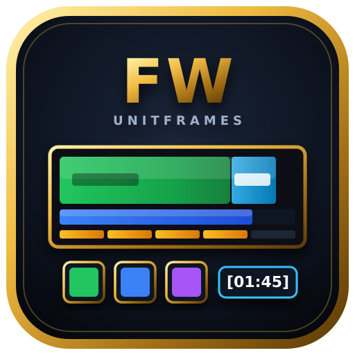
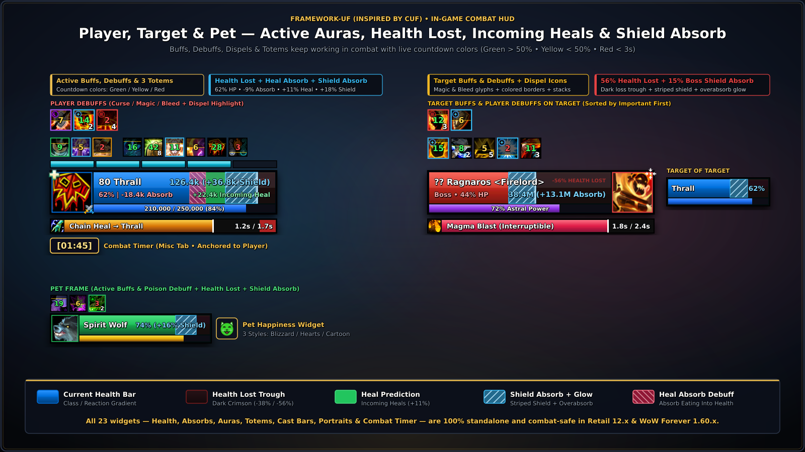
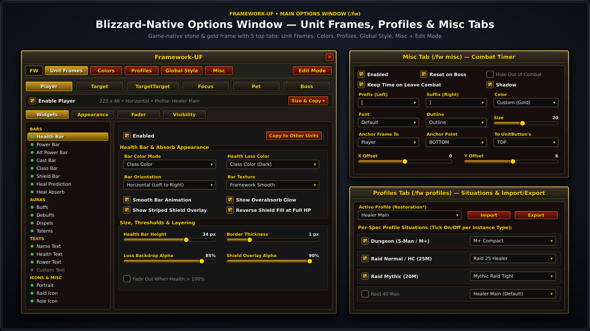
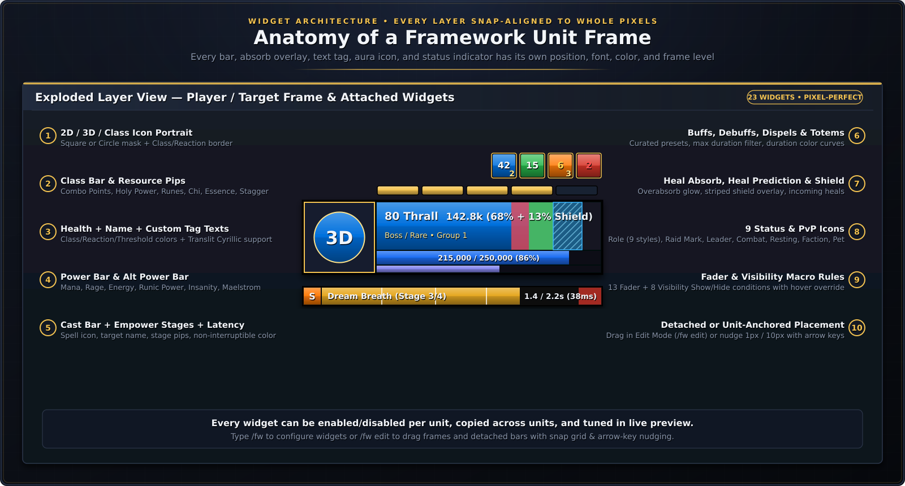
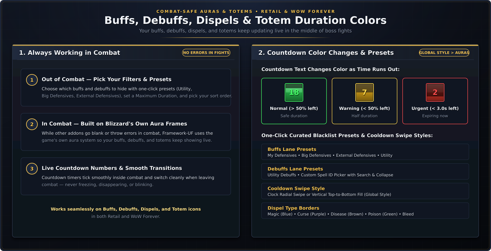
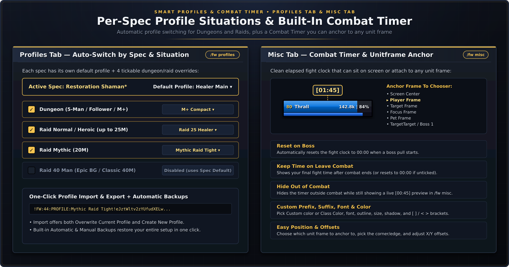
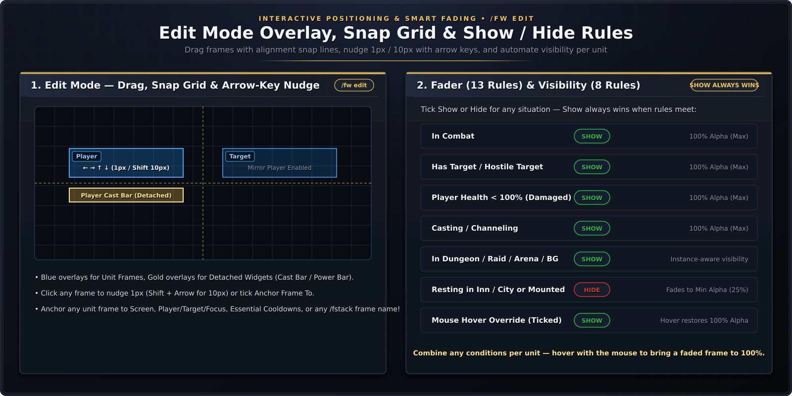

# Framework-UF (inspired by CUF)

**Standalone unit frames for Player, Target, TargetTarget, Focus, Pet and Boss 1–5 — with buffs, debuffs and totems that keep working in combat, automatic profiles per spec and dungeon/raid, and a built-in Combat Timer.**

For every class and spec · Retail and WoW Forever

---

## What you get

- **Standalone.** Needs no other addon — every texture, font, icon, and glow is built right in.
- **Auras and totems that work in combat.** Your buffs, debuffs, dispel highlights, and totems stay active and keep counting down during boss fights, with countdown text that turns yellow at 50% time left and red under 3 seconds.
- **Clear health, shield, and absorb bars.** See lost health, incoming heals, striped shield absorbs, overabsorb glow, and heal-absorb debuffs at a glance.
- **Blizzard-style options window (/fw).** Clean game-native stone and gold settings window with 5 tabs: **Unit Frames**, **Colors**, **Profiles**, **Global Style**, and **Misc**.
- **Automatic profiles per spec & situation.** Pick a profile for each specialization of your class, and tick on/off overrides for **Dungeon**, **Raid Normal/HC 25M**, **Raid Mythic**, and **Raid 40 Man** — plus one-click Profile Import and Export.
- **Built-in Combat Timer (/fw misc).** A clean fight timer that can sit anywhere on screen or anchor directly to any unit frame (**Player**, **Target**, **Focus**, **Pet**, **TargetTarget**, **Boss 1**), with *Reset on Boss* and *Hide Out of Combat*.
- **Sharp on any screen.** Every bar, border, and icon lands on whole screen pixels at any UI scale.
- **Anchor any unit frame to any `/fstack` frame name.** In Edit Mode (`/fw edit`), click any unit frame and tick **Anchor Frame To** to attach it to another Framework-UF frame, Blizzard's **Essential Cooldowns** viewer, or **any named frame on your screen** (`Existing Frame` — just type its `/fstack` object name) so your unit frames stay locked to your cooldown pack, action bars, or HUD.
- **Default Click-to-Cast & Clique supported on all frames.** Both Blizzard's built-in Click-Cast Bindings and **Clique** work out of the box on every unit frame (Player, Target, TargetTarget, Focus, Pet, and Boss 1–5).

---

## Main Options Window (/fw)

Type **/fw** in-game to open the settings window. Everything is organized into 5 top tabs (**Unit Frames**, **Colors**, **Profiles**, **Global Style**, **Misc**) with live preview as you adjust sliders and checkboxes:

---

## Everything on a Unit Frame

Each unit frame (**Player**, **Target**, **TargetTarget**, **Focus**, **Pet**, **Boss 1–5**) lets you turn on, move, resize, or copy 23 modular elements:

- **Bars:** Health Bar (with dark lost-health backdrop), Power Bar, Alt Power Bar, Cast Bar (with stage marks and latency indicator), Class Resource Bar, Shield Absorb Bar, Incoming Heal Prediction, and Heal Absorb.
- **Auras:** Buffs, Debuffs, Dispel Highlights (Magic, Curse, Disease, Poison, Bleed border and icon), and Totems — with one-click filter presets (*My Defensives*, *Big Defensives*, *External Defensives*, *Utility*) and a Maximum Duration slider.
- **Texts:** Name, Health, Power, Level, and Custom Text with full font, outline, size, color, and shadow options.
- **Icons:** 2D / 3D / Class Icon Portrait (Square or Circle), Role Icon (9 styles), Raid Target Icon, Leader Icon, Combat Icon, Ready Check, animated Resting icon, PvP Faction crest, and Hunter Pet Happiness (WoW Forever).

---

## Buffs, Debuffs & Totems in Combat

---

## Profiles, Dungeon / Raid Situations & Combat Timer

---

## Edit Mode (/fw edit), Custom `/fstack` Anchoring & Show / Hide Rules

Press **Edit Mode** in the top-right corner of **/fw** (or type **/fw edit**) to drag frames with snap lines, or click any frame to open its positioning popup:
- **Arrow-Key Pixel Nudge:** Nudge any selected frame **1 pixel** with the **Arrow Keys** (**Shift + Arrow** for **10 pixels**).
- **Anchor to Any `/fstack` Frame Object:** Tick **Anchor Frame To** on any unit frame to lock it to **Screen Center**, **Player / Target / Focus**, Blizzard's **Essential Cooldowns**, or pick **Existing Frame** and type any `/fstack` frame name from any addon on your screen (with full 9-point anchor, target point, and X/Y offsets).
- **Show / Hide & Fader Rules:** Under **Fader** and **Visibility**, tick when each unit frame should show or fade out (*In Combat*, *Has Target*, *Damaged*, *Casting*, *Dungeon*, *Raid*, *Resting*, *Mounted*, and more).

---

## Chat Commands

- **/fw** — Open or close the main options window
- **/fw edit** — Toggle Edit Mode (drag frames, snap grid, arrow-key nudge)
- **/fw profiles** — Open the **Profiles** tab (spec profiles, dungeon/raid situations, import/export, backups)
- **/fw appearance** — Open the **Global Style** tab (bar textures, fonts, cooldown swipe, countdown colors)
- **/fw colors** — Open the **Colors** tab (class, reaction, power, cast bar, shield, and dispel colors)
- **/fw misc** — Open the **Misc** tab (Combat Timer & unit frame anchor chooser)
- **/fw test** — Preview unit frames out of combat

---

## Feedback & Support

- **Discord:** [Join the community Discord](https://discord.gg/j3TH89X9wZ)
- **Bug Reports & Ideas:** [Open an issue on GitHub](https://github.com/xxxstar123/Framework-UF/issues)
- **Support:** Framework-UF is free. If you enjoy using it, you can [support the author via PayPal](https://www.paypal.com/donate/?business=mywowace%40proton.me&no_recurring=0&item_name=Support+Framework-UF&currency_code=USD).

---

## License

Copyright (c) 2026 **xxxstar123**. All rights reserved — free to download and use in World of Warcraft; no redistribution, modification, or AI use of the code without written permission (see [LICENSE](LICENSE) and [AGENTS.md](AGENTS.md)). Inspired by CUF.

*World of Warcraft is a trademark of Blizzard Entertainment, Inc. Framework-UF is not affiliated with or endorsed by Blizzard Entertainment.*
